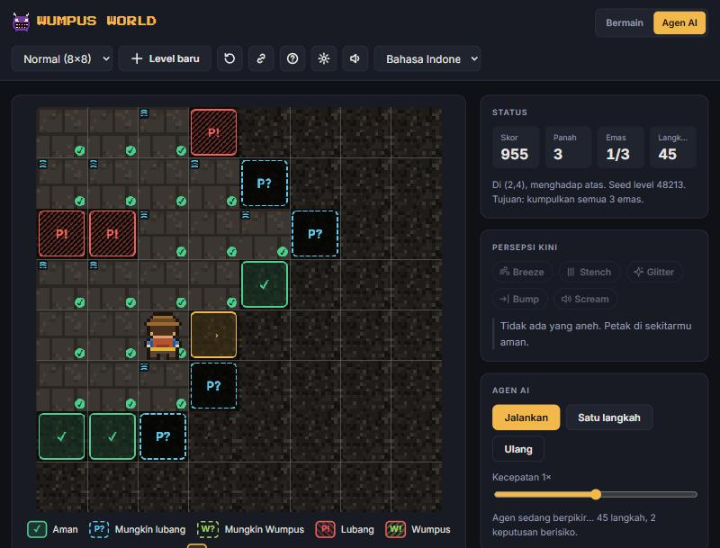

# Wumpus World Simulator

A browser-based grid game built on the classic **Wumpus World** environment (AIMA chapter 7). Explore a dark cave using only your **percepts** (Breeze, Stench, Glitter, Bump, Scream), collect the gold and avoid pits and the Wumpus — or watch a logic-based **AI agent** reason its way through, step by step.



## Features

- **Play mode** — keyboard (arrows/WASD, Space, Enter, C, R) and an on-screen D-pad for touch devices.
- **AI Agent mode** — a knowledge-based agent (inference rules K1–K11) with a `✓ / P? / W? / P! / W! / →` overlay and a **Reasoning** panel that logs every inference, e.g. `[K4] Breeze(1,0) ⇒ Pit(2,0) ∨ Pit(1,1)`.
- **Seeded levels that are always solvable** (mulberry32 + 0-1 BFS validation) and shareable links such as `#mode=normal&seed=48213`.
- Three difficulties (Easy 4×4 in AIMA style, Normal 8×8, Hard 15×8) with Classic (AIMA) or Arcade scoring.
- Percept panel with plain-language messages, an end screen that explains why you lost, player notes (right-click / long-press) and personal records.
- All pixel-art graphics and chiptune sounds are generated in code (canvas + Web Audio) — no asset files.
- Dark/light/system themes, colour-blind mode, reduced motion, responsive down to 360 px, English and Bahasa Indonesia.

## Running locally

Requires Node.js ≥ 20. There is no build step and no runtime dependency.

```bash
npm install
```

```bash
npm start
```

Open http://localhost:8080. ES modules do not run from `file://`, so always use the local server.

| Command | Purpose |
|---|---|
| `npm start` | Local static server (`server.cjs`) on `PORT` or 8080 |
| `npm test` | All tests (`node --test`) |
| `npm run test:coverage` | Tests with a coverage report |
| `npm run lint` | ESLint, including layer-boundary rules |
| `npm run bench:agent` | Benchmark the AI agent on seeds 1…1000 per mode |
| `node scripts/build-icons.js` | Regenerate `img/favicon.svg` from the Wumpus sprite |

## Architecture

```
js/engine/  pure, deterministic rules: createGame(config, seed), step(state, action)
js/agent/   knowledge-based agent: sees observations only, never state.world
js/app/     controller, agent runner, share links, storage, settings
js/ui/      canvas renderer, pixel-art sprites, synthesized audio, HUD, input, dialogs, i18n
js/main.js  wires everything together
```

## AI agent benchmark

`npm run bench:agent` (seeds 1…1000, classic scoring):

| Mode | Won | Lost | Climbed out without gold | Average score | Deaths without a risky decision |
|---|---|---|---|---|---|
| Easy | 37.5% | 0.0% | 62.5% | 446 | 0 |
| Normal | 60.5% | 39.5% | — | 2302 | 0 |
| Hard | 77.9% | 22.1% | — | 9423 | 0 |

In Easy mode, when no cell can be proven safe, the agent heads home and climbs out instead of taking a risk. Its win rate is therefore below the 70% target, but it never dies in this mode.
